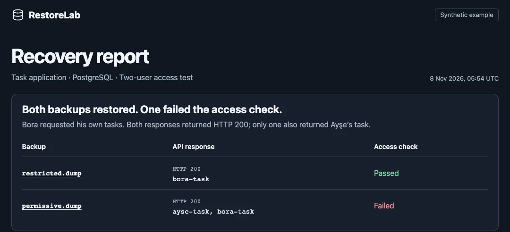

# RestoreLab

[Türkçe](README.tr.md) · [Open the sample report](https://mehmetfatihdogan.com.tr/assets/demos/restorelab-en)

You have a PostgreSQL backup. Which copy can you actually recover from, and what will work after you restore it? RestoreLab runs repeatable recovery drills on your machine or CI runner. It records the restore separately from application checks and shows the newest passing backup for a given application and test-suite version.



## Run the demo

You need **Node.js 22+ and a running Docker engine** on macOS or Linux. Run as a regular user with Docker access.

```sh
git clone https://github.com/fatihdogann/restorelab.git
cd restorelab
report_dir=$(mktemp -d)
export RESTORELAB_STATE="$report_dir/history"
node restorelab.mjs demo "$report_dir" --docker
RESTORELAB_LANG=en node restorelab.mjs serve examples/demo-panel.mjs
```

Open `index.en.html` for the English report, or visit the loopback address printed by the panel. The demo builds two synthetic archives. Both restore and both task API reads return HTTP 200. One exposes another user’s task, so its access check fails. The command succeeds when it reproduces both expected outcomes.

For an HTML/JSON report without panel history, install PostgreSQL 16 command-line tools and run the demo without `--docker`.

## Check your own backup

Start with a trusted custom-format archive created by `pg_dump -Fc`. Pick a table your application needs and set the backup timestamp and application version before running the starter profile.

```sh
export DRILL_PROJECT_ID=inventory
export DRILL_APP_VERSION=v1.2.0
export DRILL_BACKUP=/absolute/path/inventory.dump
export DRILL_BACKUP_AT=2026-11-08T00:00:00Z
export DRILL_REQUIRED_TABLE=public.orders

node restorelab.mjs drill examples/postgres-profile.mjs
RESTORELAB_LANG=en node restorelab.mjs serve examples/postgres-profile.mjs
```

Use a lowercase, schema-qualified table name. The starter verifies that the table is present in the restored database. Choose a PostgreSQL image matching your backup’s major version and extensions with `DRILL_POSTGRES_IMAGE` if needed. The starter omits original owners and grants for its table check. If you need to verify access rules, provision the application’s roles in your profile and use the Docker helper’s default restore behavior, which preserves owners and grants.

To go further, copy the [starter profile](examples/postgres-profile.mjs) and replace its table check with an invariant that matters to your application, such as an authenticated read or a cross-user access check. An `exercise` calls `restoreBackup` with the actual restore operation and returns explicit expected and observed results. Change the suite version when you change what the profile tests.

## Run it regularly

Call `drill` from cron, a systemd timer, or CI. A failed drill exits nonzero and keeps its result. Set `RESTORELAB_STATE` to choose a private history directory. It defaults to `~/.local/state/restorelab`. The panel listens on loopback and reads this history.

Use trusted archives and trusted JavaScript profiles. [PostgreSQL restores can execute SQL and code from the source database](https://www.postgresql.org/docs/current/app-pgrestore.html). The bundled PostgreSQL helper uses a network-disabled Docker container and removes it after each drill. Keep backup files and history private and record only synthetic identifiers or redacted values in checks.

See the [Supabase Auth and REST case study](docs/supabase-case-study.md) for a fuller example that restores synthetic accounts and exercises application access over HTTP.

## License

[MIT](LICENSE)

## Developer

**Mehmet Fatih Doğan** — Software Developer.

- 🌐 Portfolio & Contact: [mehmetfatihdogan.com.tr](https://mehmetfatihdogan.com.tr)
- 💻 GitHub: [@fatihdogann](https://github.com/fatihdogann)

For questions, bug reports, or feedback about this project, feel free to contact me through [my website](https://mehmetfatihdogan.com.tr).
