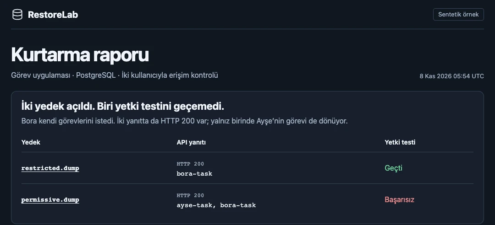

# RestoreLab

[English](README.md)

PostgreSQL yedeğini geçici bir ortamda geri yükler ve uygulamanın kurtarılan verilerle çalıştığını sınar. Her uygulama ve test paketi sürümü için denenen en yeni yedeği ve testleri geçen en yeni yedeği ayrı gösterir.



## Örnek tatbikat

macOS veya Linux üzerinde Node.js 22+, PostgreSQL 16 komut satırı araçları ve Docker gerekir. Komutları normal bir kullanıcı hesabıyla çalıştır.

```sh
node --test
node restorelab.mjs demo "$HOME/Downloads/restorelab-demo" --docker
node restorelab.mjs serve examples/demo-panel.mjs
```

Oluşturulan HTML raporunu veya terminaldeki yerel panel adresini aç. Her rapor için yeni bir çıktı dizini kullan. Sentetik demoyu geçici yerel PostgreSQL kümeleriyle çalıştırmak için `--docker` seçeneğini kaldır.

İki yedek de yüklenir ve görev API’si HTTP 200 döner. Erişim politikası fazla geniş olan yedekte Bora, Ayşe’nin örnek görevini de görür. Rapor bu farkı ve görev yazma kontrolünü kaydeder.

## Kendi tatbikatın

[Yerel profil örneği](examples/postgres-profile.mjs) yedek dosyasını, yedek zamanını ve testlerin hangi uygulama sürümüne ait olduğunu tanımlar. `drill` komutunu cron veya systemd ile düzenli çalıştırabilirsin. Tatbikat kayıtları varsayılan olarak `~/.local/state/restorelab` dizininde kalır. Yalnız güvendiğin profilleri ve yedekleri çalıştır, rapor kontrollerinde sentetik veya maskelenmiş değer kullan.

[TaskWork örneği](examples/taskwork.mjs), yerel Supabase’te iki sentetik kullanıcı oluşturur ve yeni ortama geri yükleme sonrası gerçek Auth ve REST uçlarından giriş, okuma, yazma ve kullanıcı izolasyonunu sınar. Bu doğrulama TaskWork’ün temel şeması ile veritabanı/API akışını kapsar.

## Lisans

[MIT](LICENSE)

## Geliştirici

**Mehmet Fatih Doğan** — yazılım geliştirici.

[Portfolyo ve iletişim](https://mehmetfatihdogan.com.tr/) · [GitHub](https://github.com/fatihdogann)
